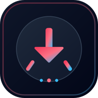
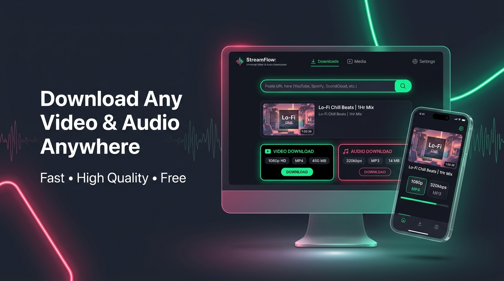
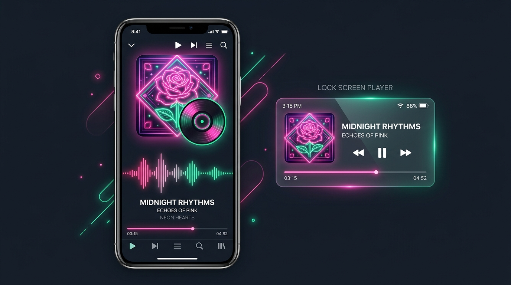
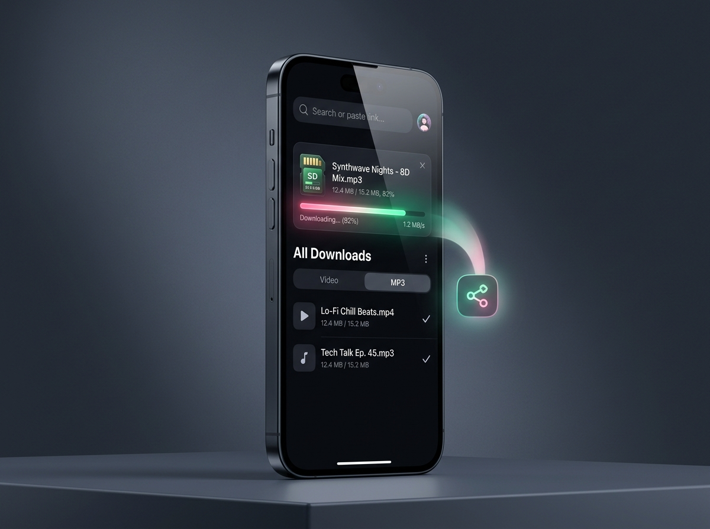
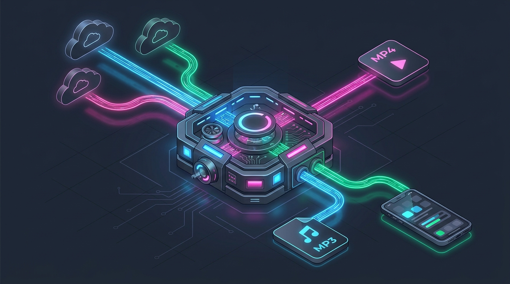

<p align="center">
  
</p>

<h1 align="center">🎬 Universal Video & Audio Downloader</h1>

<p align="center">
  <strong>সার্বজনীন ভিডিও ও অডিও ডাউনলোডার (PWA Web Share Target, Background Music Player & Android APK)</strong>
</p>

<p align="center">
  
</p>

একটি আধুনিক, দ্রুতগতির এবং সম্পূর্ণ রেসপনসিভ ওয়েব ও অ্যান্ড্রয়েড অ্যাপ্লিকেশন, যা ইউটিউব, ফেসবুক, ইনস্টাগ্রাম, টিকটকসহ বিভিন্ন জনপ্রিয় প্ল্যাটফর্মের যেকোনো ভিডিও ও গান সহজে সর্বোচ্চ কোয়ালিটিতে (**MP3 320kbps** ও **Full HD / 4K MP4**) ডাউনলোড করতে সাহায্য করে। এতে রয়েছে **PWA Web Share Target**, **ব্যাকগ্রাউন্ড অডিও প্লেয়ার (অটো-নেক্সট ও লক-স্ক্রিন সাপোর্ট)**, **মাল্টি-URL ব্যাচ ডাউনলোডার**, **মেমোরি কার্ড (SD Card) ডিরেক্ট সেভ** এবং **অফলাইন হিস্ট্রি প্লেয়ার**।

---

## 📸 অ্যাপ প্রিভিউ ও ভিজ্যুয়াল গ্যালারি (Visual Showcase)

<table>
  <tr>
    <td width="50%" align="center">
      
      <br />
      <strong>🎵 ব্যাকগ্রাউন্ড মিউজিক ও লক-স্ক্রিন প্লেয়ার</strong>
      <br />
      <sub>অ্যাপ থেকে বের হয়ে গেলেও বা স্ক্রিন লক থাকলেও অডিও প্লে ও অটো-নেক্সট চালু থাকে</sub>
    </td>
    <td width="50%" align="center">
      
      <br />
      <strong>📲 PWA শেয়ার টার্গেট ও SD কার্ড সেভ</strong>
      <br />
      <sub>অন্য অ্যাপ থেকে সরাসরি শেয়ার করে মেমোরি কার্ড বা ফোন মেমোরিতে দ্রুত সংরক্ষণ</sub>
    </td>
  </tr>
</table>

---

## ✨ প্রধান বৈশিষ্ট্যসমূহ (Key Features)

### ১. ⚡ মাল্টি-প্ল্যাটফর্ম ভিডিও ও অডিও এক্সট্র্যাকশন
- **সমর্থিত প্ল্যাটফর্ম:** YouTube, YouTube Music, Facebook, Instagram Reels, TikTok (No-Watermark), Twitter/X, Vimeo এবং সরাসরি ভিডিও/অডিও লিঙ্ক (`.mp4`/`.webm`/`.mp3`)।
- **এক-ক্লিকে বিশ্লেষণ:** যেকোনো প্ল্যাটফর্মের শেয়ার লিঙ্ক পেস্ট করলেই টাইটেল, থাম্বনেইল, চ্যানেল নাম, ভিউ কাউন্ট ও সময়কাল স্বয়ংক্রিয়ভাবে লোড হয়।

### ২. 🎵 ব্যাকগ্রাউন্ড ইউটিউব মিউজিক ও অ্যালবাম প্লেয়ার
- **অবিরাম ব্যাকগ্রাউন্ড প্লেব্যাক:** নেটিভ HTML5 অডিও স্ট্রিমিং ও Android Foreground Service (`MediaPlayer` + `MediaSession` + `WifiLock`) ব্যবহারের ফলে অ্যাপ মিনিমাইজ বা স্ক্রিন লক করলেও গান বন্ধ হয় না।
- **অটো-নেক্সট প্লেলিস্ট:** একটি গান শেষ হলে স্বয়ংক্রিয়ভাবে পরবর্তী গান প্রি-ওয়ার্ম হয়ে সাথে সাথে চালু হয়।

### ৩. 🎞️ বহুমুখী ফরম্যাট ও কোয়ালিটি অপশন
- **হাই-রেজোলিউশন ভিডিও:** 4K Ultra HD, 1080p Full HD (60fps), 720p HD, 480p SD এবং 360p মোবাইল MP4 ফরম্যাট।
- **ক্রিস্টাল ক্লিয়ার অডিও:** MP3 320 kbps (স্টুডিও কোয়ালিটি), M4A 256 kbps এবং MP3 128 kbps (দ্রুত ডাউনলোড)।
- **রিয়েল-টাইম প্রোগ্রেস বার:** এনকোডিং স্পিড, প্রোগ্রেস শতাংশ (`%`), আনুমানিক সময় এবং ডাউনলোড সাইজ লাইভ দেখা যায়।

### ৪. 📲 PWA Web Share Target (মোবাইল থেকে সরাসরি শেয়ার ও ডাউনলোড)
- যেকোনো অ্যান্ড্রয়েড বা মোবাইল ব্রাউজারে অ্যাপটি **PWA হিসেবে ইনস্টল (Add to Home Screen)** অথবা **Android APK** হিসেবে ব্যবহার করা যায়।
- ইউটিউব বা ইনস্টাগ্রাম অ্যাপে কোনো ভিডিও দেখার সময় **"Share" ➔ "Downloader"** সিলেক্ট করলেই লিংকটি কপি না করেই সরাসরি এই অ্যাপে ওপেন হয়ে ডাউনলোড অপশন নিয়ে আসবে!

### ৫. 📦 মাল্টি-URL ব্যাচ প্রসেসিং কিউ ও অটো-রিট্রাই
- একসাথে একাধিক ভিডিওর লিঙ্ক পেস্ট করে কিউ (Queue) তৈরি ও প্রতিটি ভিডিওর জন্য আলাদা ফরম্যাট নির্ধারণের সুবিধা।
- নেটওয়ার্ক বিঘ্ন বা সার্ভার ত্রুটির কারণে কোনো ডাউনলোড ব্যর্থ হলে **"অটো-রিট্রাই (Auto-Retry)"** বাটনে এক ক্লিকেই পুনরায় শুরু হয়।

### ৬. 📂 ডাউনলোড হিস্ট্রি, ব্যাকআপ ও ইন-লাইন প্লেয়ার
- ইতিপূর্বে ডাউনলোড করা সমস্ত ফাইল তারিখ, সাইজ ও ফরম্যাট সহ সংরক্ষিত থাকে, JSON/CSV ব্যাকআপ এবং Google ক্লাউড সিঙ্ক সাপোর্টসহ।
- বাংলা ও ইংরেজি — দ্বিভাষিক ইন্টারফেস সুবিধা।

---

## 🛠️ আর্কিটেকচার ও টেক স্ট্যাক (Architecture & Tech Stack)

<p align="center">
  
</p>

| স্তর (Layer) | ব্যবহৃত প্রযুক্তি (Technologies Used) |
|---|---|
| **Frontend UI** | React 18, TypeScript, Tailwind CSS, Lucide React Icons, Canvas Confetti |
| **Music & Media Player** | Native HTML5 `<audio>` Engine, MediaSession API, Background Keep-Alive |
| **PWA & Mobile Shell** | Web App Manifest (`manifest.json`), Web Share Target API v2, Capacitor Android Foreground Service |
| **Backend Server** | Node.js, Express, `tsx` (Dev runner), `esbuild` (Production bundler) |
| **Extraction & Proxy Engines** | EtaCloud High-Speed Extractor, TikWM No-Watermark Bypass, `yt-dlp` Native Client, FFmpeg Stream Proxy |

---

## 📁 প্রজেক্ট স্ট্রাকচার (Directory Structure)

```text
├── public/
│   ├── icon.svg                      # ভেক্টর অ্যাপ আইকন
│   ├── pwa-192x192.png               # PWA আইকন (192x192)
│   ├── pwa-512x512.png               # PWA আইকন (512x512)
│   ├── manifest.json                 # PWA Manifest ও Share Target কনফিগারেশন
│   └── sw.js                         # অফলাইন ও পুশ নোটিফিকেশন সার্ভিস ওয়ার্কার
├── server/
│   ├── bypassEngine.ts               # মাল্টি-টিয়ার এক্সট্র্যাক্টর ও স্ট্রিম প্রক্সি ইঞ্জিন
│   └── youtubeSearch.ts              # ইউটিউব গান ও অ্যালবাম সার্চ ইঞ্জিন
├── src/
│   ├── assets/images/                # README ও ভিজ্যুয়াল শোকেস ইমেজসমূহ
│   ├── components/
│   │   ├── ActiveDownloadBar.tsx     # ভাসমান ডাউনলোড প্রোগ্রেস ও সেভ বার
│   │   ├── BatchDownloaderView.tsx   # মাল্টি-URL ব্যাচ ডাউনলোড কিউ
│   │   ├── DownloaderView.tsx        # মূল সিঙ্গেল-ভিডিও ডাউনলোডার স্ক্রিন
│   │   ├── DownloadHistoryView.tsx   # হিস্ট্রি লিস্ট, প্লেয়ার, ব্যাকআপ ও অটো-রিট্রাই
│   │   ├── MusicPlayerBar.tsx        # ব্যাকগ্রাউন্ড ও লক-স্ক্রিন অডিও প্লেয়ার বার
│   │   ├── Navbar.tsx                # হেডার নেভিগেশন ও ল্যাঙ্গুয়েজ সুইচ
│   │   ├── VideoResultCard.tsx       # ভিডিও মেটাডেটা, প্লেয়ার ও ফরম্যাট লিস্ট
│   │   └── YouTubeMusicView.tsx      # ইউটিউব মিউজিক ও অ্যালবাম সার্চ ট্যাব
│   ├── services/
│   │   ├── androidBackgroundAudio.ts # Android Foreground Service ব্রিজ
│   │   ├── backgroundKeepAlive.ts    # ব্যাকগ্রাউন্ড প্লেব্যাক ও MediaSession সাপোর্ট
│   │   ├── downloadManager.ts        # ডাউনলোড ট্র্যাকিং, কনভার্সন ও ফাইল সেভ ইঞ্জিন
│   │   ├── storagePreferenceManager.ts # SD কার্ড ও ফোন মেমোরি সেভ ম্যানেজার
│   │   └── videoExtractor.ts         # URL বিশ্লেষণ, প্ল্যাটফর্ম ডিটেকশন ও মেটাডেটা
│   ├── utils/translations.ts         # বাংলা ও ইংরেজি সম্পূর্ণ অনুবাদ ডিকশনারি
│   └── App.tsx                       # মূল স্টেট ম্যানেজার ও রাউটিং
├── android/                          # Capacitor Android প্রজেক্ট ও নেটিভ ব্যাকগ্রাউন্ড সার্ভিস
├── server.ts                         # এক্সপ্রেস ব্যাকএন্ড প্রক্সি ও কনভার্সন এপিআই
├── metadata.json                     # অ্যাপ মেটাডেটা
└── package.json                      # প্যাকেজ ও স্ক্রিপ্ট কনফিগারেশন
```

---

## 🚀 লোকাল সেটআপ ও রান নির্দেশিকা (Getting Started)

### ১. ডিপেন্ডেন্সি ইনস্টল করুন:
```bash
npm install
```

### ২. ডেভেলপমেন্ট সার্ভার চালু করুন:
```bash
npm run dev
```
অ্যাপটি সরাসরি `http://localhost:3000` এ রান হবে।

### ৩. প্রোডাকশন বিল্ড তৈরি করুন:
```bash
npm run build
```
এটি ভিট ফ্রন্টএন্ড এবং এক্সপ্রেস ব্যাকএন্ডকে অপ্টিমাইজড `dist/` ফোল্ডারে বান্ডল করবে।

### ৪. প্রোডাকশন সার্ভার স্টার্ট করুন:
```bash
npm start
```

---

## 📲 PWA Web Share Target কনফিগারেশন বিবরণ

অ্যাপটির `public/manifest.json` ফাইলে Web Share Target API কনফিগার করা হয়েছে:

```json
{
  "name": "Universal Video & Audio Downloader",
  "short_name": "Downloader",
  "start_url": "/",
  "display": "standalone",
  "theme_color": "#090d16",
  "share_target": {
    "action": "/",
    "method": "GET",
    "params": {
      "title": "title",
      "text": "text",
      "url": "url"
    }
  }
}
```

### কীভাবে শেয়ার কাজ করে:
1. ব্যবহারকারী মোবাইল ব্রাউজারে (Chrome / Edge / Safari) অ্যাপটি ওপেন করে **"Add to Home Screen"** চাপবেন।
2. অ্যান্ড্রয়েড সিস্টেম তখন এই অ্যাপটিকে সিস্টেম শেয়ার শিটে রেজিস্টার করে নেয়।
3. যখন ব্যবহারকারী অন্য যেকোনো অ্যাপে (YouTube, Facebook, Browser) কোনো লিঙ্ক শেয়ার করবেন:
   - সিস্টেম শেয়ার উইন্ডো থেকে **"Downloader"** নির্বাচন করবেন।
   - ব্রাউজার অ্যাপটিকে `/?url=<shared_link>` কুয়েরি প্যারামিটার সহ লঞ্চ করবে।
   - অ্যাপের `useEffect` ও `extractUrlFromText` স্বয়ংক্রিয়ভাবে লিঙ্কটি সনাক্ত করে ভিডিও কার্ড লোড করবে!

---

## 🔌 ব্যাকএন্ড এপিআই এন্ডপয়েন্টস (Backend Endpoints)

| মেথড | এন্ডপয়েন্ট | বিবরণ |
|---|---|---|
| `GET` | `/api/health` | সার্ভার স্বাস্থ্য পরীক্ষা |
| `GET` | `/api/youtube/search` | ইউটিউব গান ও অ্যালবাম সার্চ করা |
| `GET` | `/api/audio/stream` | HTTP Range সাপোর্টসহ নেটিভ ব্যাকগ্রাউন্ড অডিও স্ট্রিম |
| `POST` | `/api/convert/start` | ভিডিও URL পাঠিয়ে ব্যাকগ্রাউন্ড অডিও/ভিডিও কনভার্সন জব শুরু করা |
| `GET` | `/api/convert/progress` | কনভার্সন প্রোগ্রেস ও প্রস্তুত ডাউনলোড লিঙ্ক পোলিং করা |
| `GET` | `/api/proxy-download` | পরিষ্কার বাংলা/ইংরেজি ফাইলনেম সহ সরাসরি ফাইল ডাউনলোড ও স্ট্রিমিং প্রক্সি |

---

## 📄 লাইসেন্স ও সৌজন্য (License)
এই প্রজেক্টটি শিক্ষামূলক ও ব্যক্তিগত ব্যবহারের উদ্দেশ্যে উন্মুক্ত (MIT License)। যেকোনো বৈধ কপিরাইটযুক্ত কনটেন্ট ডাউনলোড করার সময় প্রযোজ্য সেবার শর্তাবলি মেনে চলুন।

